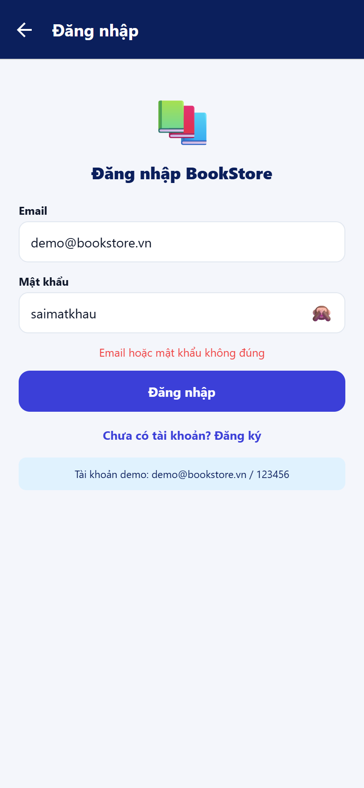

# Trả lời câu hỏi bổ sung — Buổi 8 (BookStore)

MSSV: 21095551 · Họ tên: Mai Lưu Hữu Vinh

## 1. Cờ `ready`

Ở lần render đầu, giỏ hàng trong store còn rỗng (`[]`) và `usePersistence` mới bắt đầu đọc AsyncStorage (đọc là bất đồng bộ). Nếu `useAutoPersist` bỏ điều kiện `ready`, effect của nó chạy ngay sau lần render đầu và ghi `[]` vào `@bookstore/cart`, đè lên giỏ cũ trước khi lần đọc kịp trả kết quả. Lúc đó hàm đọc có thể nhận về mảng rỗng, nên giỏ đã lưu mất. Cờ `ready` chỉ bật sau khi đọc xong và nạp vào store (`setReady(true)`), nên chỉ từ render sau đó hàm ghi mới được chạy.

Khi thử thật trên bản web, bỏ `ready` vẫn chưa làm mất giỏ, vì lệnh đọc được gửi đi trước lệnh ghi và `localStorage` chạy tuần tự. Vậy đây là lỗi phụ thuộc thứ tự (race): chạy đúng chỉ do may mắn về thứ tự và có thể hỏng khi ghi đến trước, nên vẫn phải giữ điều kiện `ready`.

## 2. Token giả

Hai điểm không an toàn: (1) mật khẩu nằm sẵn trong `db.json` dạng chữ thường và API `GET /users?email=...` trả cả mật khẩu về máy, rồi chính app tự so mật khẩu, nên ai mở tab Network cũng xem được mật khẩu của người khác; (2) token tự tạo (`fake-token-<id>-<giờ>`) có quy luật đoán được và không có chữ ký, nên ai cũng làm giả được, còn server không kiểm tra gì. Ở hệ thống thật, server kiểm tra mật khẩu (đã băm bằng bcrypt/argon2) và cấp token có thời hạn (ví dụ JWT có chữ ký). Token nên lưu bằng `expo-secure-store` (Keychain trên iOS, Keystore trên Android) thay cho AsyncStorage vì AsyncStorage không mã hóa.

## 3. Hai effect trong `CartItemRow`

`useState(item.quantity)` chỉ lấy giá trị ban đầu ở lần render đầu tiên, nên khi `item.quantity` trong store đổi từ nơi khác thì số hiển thị không tự đổi theo. Ví dụ: tab Giỏ hàng đang mở sẵn với Clean Code × 1, ta sang trang chi tiết bấm "Thêm vào giỏ" thêm lần nữa (store thành 2), quay lại giỏ thì nút vẫn hiện 1 còn tổng tiền tính theo 2, hai số bị lệch nhau. Effect `setQty(item.quantity)` đồng bộ lại số đó. Effect ghi store thì cố ý chỉ phụ thuộc `[debouncedQty]`, vì nếu thêm `item.quantity` thì `debouncedQty` còn giữ số cũ sẽ bị ghi ngược lên store, làm mất lần thêm vừa rồi.

## 4. Một nguồn state

Nếu mỗi nơi giữ `useState` riêng thì tim ở lưới và ở trang chi tiết là hai biến độc lập, chỉ khởi tạo ban đầu rồi tách rời nhau. Bấm tim ở lưới rồi mở trang chi tiết, tim ở đó vẫn trắng, và bỏ tim ở màn Yêu thích thì tim ở lưới vẫn đỏ. Với store, `HeartButton` ở mọi nơi cùng đọc `ids` của wishlist và cùng gọi `toggle`, nên chỉ có một sự thật duy nhất và mọi tim luôn khớp nhau. Màn Yêu thích cũng chỉ lọc `books` theo `ids` trong store chứ không giữ bản sao.

## 5. Code bổ sung — hiện/ẩn mật khẩu

Thêm một state `showPassword` và dùng nó điều khiển `secureTextEntry`, kèm nút 👁 đặt cuối ô mật khẩu (qua prop `right` của `FormField`). Bấm nút thì đảo giá trị, và khi đang hiện thì đổi thành 🙈 để người dùng biết bấm lại sẽ ẩn.

```tsx
// LoginScreen.tsx
const [showPassword, setShowPassword] = useState(false); // false = đang ẩn

<FormField
  label="Mật khẩu"
  value={password}
  onChangeText={setPassword}
  error={errors.password}
  secureTextEntry={!showPassword}   // ẩn khi showPassword = false
  right={
    <Pressable onPress={() => setShowPassword((v) => !v)} hitSlop={8}
      accessibilityLabel={showPassword ? "Ẩn mật khẩu" : "Hiện mật khẩu"}>
      <Text>{showPassword ? "🙈" : "👁"}</Text>
    </Pressable>
  }
/>
```

Ảnh kết quả (sau khi bấm 👁, mật khẩu đang nhập hiện rõ thành chữ và nút đổi sang 🙈):


